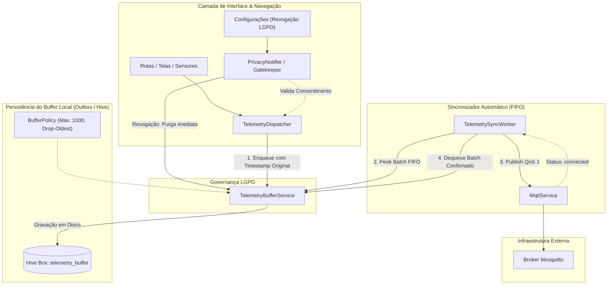

# Design Doc: Buffer Local de Telemetria e Tolerância a Falhas Offline no Flutter

## 1. Contexto e Objetivos

Em eventos institucionais, feiras ou ambientes com infraestrutura de rede instável, a indisponibilidade momentânea do broker MQTT ou da conexão de internet não pode causar perda de dados de telemetria nem degradar a experiência de uso do aplicativo DSM Conecta.
A **Issue #8** implementa o mecanismo de buffer persistente em disco (padrão *Outbox*) no cliente Flutter (`apps/client`), garantindo tolerância a falhas offline, retenção ordenada (FIFO), preservação de timestamps UTC originais, limite configurável de armazenamento local com política de descarte (*drop-oldest*) e purga imediata em caso de revogação de consentimento LGPD.

### 1.1 Requisitos Vinculados
- **RF08 & RNF11:** Operação offline transparente sem interrupção do app, retendo mensagens localmente durante falhas de comunicação e retransmitindo na reconexão.
- **RF12, RN01 & RN02:** Conformidade estrita com LGPD: respeito a consentimento ativo, descarte imediato de dados locais ao revogar autorização ou limpar sessão.
- **RNF01 & RNF02:** Compatibilidade multiplataforma unificada (Android, Web e Desktop) e publicação MQTT com Qualidade de Serviço 1 (QoS 1).
- **RNF06:** Resiliência na transmissão e esvaziamento ordenado sem sobrecarregar a memória do cliente.

---

## 2. Arquitetura Geral do Subsistema



---

## 3. Especificação Detalhada dos Componentes

### 3.1 Armazenamento Local com Hive (`core/telemetry/buffer/`)

#### A. Dependências
Adicionadas em `apps/client/pubspec.yaml`:
- `hive: ^2.2.3` (armazenamento NoSQL rápido chave-valor multiplataforma em Dart)
- `hive_flutter: ^1.1.0` (inicialização facilitada compatível com Android, iOS, Desktop e Web via IndexedDB)

#### B. Modelo de Item no Buffer (`telemetry_buffer_item.dart`)
Estrutura armazenada no banco:
```dart
class TelemetryBufferItem {
  final String id;
  final String topic;
  final String payloadJson;
  final DateTime createdAt;

  const TelemetryBufferItem({
    required this.id,
    required this.topic,
    required this.payloadJson,
    required this.createdAt,
  });

  Map<String, dynamic> toMap() => {
    'id': id,
    'topic': topic,
    'payloadJson': payloadJson,
    'createdAt': createdAt.toIso8601String(),
  };

  factory TelemetryBufferItem.fromMap(Map<dynamic, dynamic> map) {
    return TelemetryBufferItem(
      id: map['id'] as String,
      topic: map['topic'] as String,
      payloadJson: map['payloadJson'] as String,
      createdAt: DateTime.parse(map['createdAt'] as String),
    );
  }
}
```

#### C. Abstração e Adaptador de Armazenamento (`telemetry_buffer_storage.dart`)
Interface abstrata para facilitar testes unitários com fakes/mocks em memória:
- `Future<void> init()`
- `Future<void> put(String id, TelemetryBufferItem item)`
- `Future<void> delete(String id)`
- `Future<void> deleteBatch(List<String> ids)`
- `Future<List<TelemetryBufferItem>> getAll()`
- `Future<int> count()`
- `Future<void> clear()`

---

### 3.2 Serviço de Buffer (`telemetry_buffer_service.dart`)

- **Controle de Capacidade e Política de Descarte:**
  - Capacidade máxima configurável: `maxCapacity = 1000` itens.
  - Ao enfileirar (`enqueue`):
    - Se `count() >= maxCapacity`: busca o(s) item(ns) mais antigo(s) e executa remoção (*drop-oldest*), mantendo a integridade da memória e persistência do dispositivo.
    - Grava o novo item com seu payload JSON integral (garantindo que o campo `timestamp` original UTC gerado pelo dispatcher seja preservado intacto).
- **Consumo Ordenado (FIFO):**
  - `peekBatch({int limit = 50})`: retorna os próximos itens ordenados crescentemente por `createdAt`.
  - `dequeueBatch(List<String> ids)`: remove os itens cujos envios foram confirmados.
- **Purga Total (LGPD):**
  - `clear()`: remove imediatamente todas as entradas pendentes no disco.

---

### 3.3 Sincronizador Automático (`telemetry_sync_worker.dart`)

- **Escuta de Conectividade:**
  - Monitora o stream de estado de conexão `MqttService.statusStream`.
  - Ao transicionar para `MqttConnectionStatus.connected` (ou ao ser acionado imediatamente após um novo `enqueue` se já estiver conectado):
    - Inicia a rotina de sincronização de forma não concorrente (`_isSyncing` guard lock).
- **Ciclo de Esvaziamento em Lote:**
  1. Recupera lote de até 50 itens via `peekBatch`.
  2. Para cada item:
     - Confirma se o broker permanece `connected`. Caso desconecte durante o processo, encerra o ciclo graciosamente para não perder itens.
     - Publica no tópico registrado (`item.topic`) utilizando `mqttService.publish(item.topic, jsonDecode(item.payloadJson))`.
     - Adiciona o ID à lista de confirmados.
  3. Chama `dequeueBatch(confirmedIds)` para limpar do disco.
  4. Repete enquanto houver itens e a conexão permanecer ativa.

---

### 3.4 Integração com `TelemetryDispatcher` e Governança LGPD

1. **`TelemetryDispatcher` (`core/telemetry/telemetry_dispatcher.dart`):**
   - No envio de interações (`dispatchScreenInteraction` e futuras telemetrias):
     - Valida `gatekeeper.canEmitTelemetry()`.
     - Serializa o `TelemetryEventModel` com o `timestamp` UTC do momento exato da interação.
     - Enfileira no `TelemetryBufferService`.
     - Notifica o `TelemetrySyncWorker` para descarregar caso o MQTT já esteja online.
2. **Integração com `PrivacyNotifier` e `SettingsScreen`:**
   - Na ação de revogação de consentimento (`revokeConsent`) ou exclusão dos dados da sessão (`clearData`), o `TelemetryBufferService.clear()` é invocado, garantindo que nenhum dado coletado permaneça em disco sem respaldo legal.

---

## 4. Estratégia de Testes Automatizados (TDD)

Todas as classes e fluxos seguirão rigorosamente o ciclo **Red-Green-Refactor** com cobertura superior a 70%:

1. **`test/core/telemetry/buffer/telemetry_buffer_item_test.dart`:**
   - Serialização e desserialização de `TelemetryBufferItem` preservando tipos e formato UTC.
2. **`test/core/telemetry/buffer/telemetry_buffer_service_test.dart`:**
   - Enfileiramento sequencial e recuperação FIFO de lotes.
   - Aplicação da política de capacidade máxima com descarte do mais antigo (*drop-oldest*).
   - Esvaziamento (`clear`) limpando todos os itens em disco.
3. **`test/core/telemetry/buffer/telemetry_sync_worker_test.dart`:**
   - Ativação do sincronismo mediante transição de status para `connected`.
   - Publicação ordenada das mensagens com QoS 1 via mock do `MqttService`.
   - Interrupção graciosa do envio caso o MQTT desconecte no meio do lote, retendo mensagens restantes.
   - Prevenção de execuções concorrentes duplicadas.
4. **`test/core/telemetry/telemetry_dispatcher_buffer_integration_test.dart`:**
   - Verificação de que eventos gerados offline ficam retidos no buffer com timestamp original.
   - Verificação de que a revogação de consentimento apaga o buffer sem emissão posterior.
